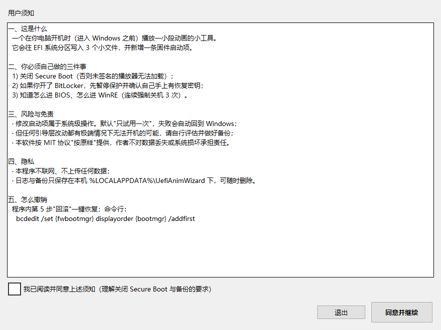
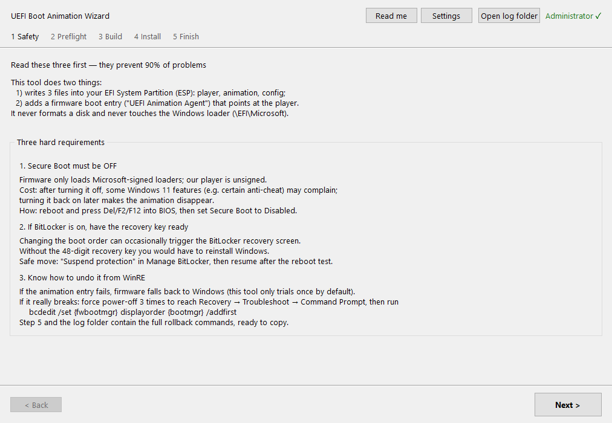
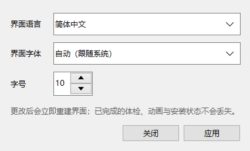
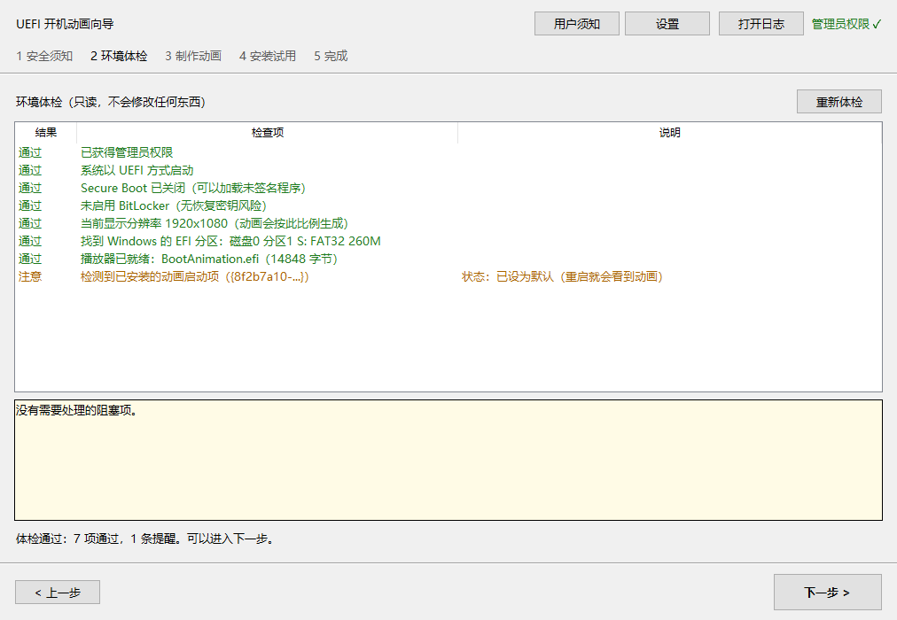

# UEFI 开机动画向导 · 使用指南

> 适用于 `UefiAnimWizard.exe`（本文写作 1.1.0）。
> 这是一份**给新手看的**操作手册：照着做，最坏情况也不会把电脑变砖；真出问题，第 7 节有救砖命令。

---

## 0. 先读这 30 秒

这个工具会在你的 EFI 分区（ESP）里放 3 个文件，并在固件启动项里加一条
"UEFI Animation Agent"，让电脑**开机先播一段动画，播完自动进 Windows**。

它**不会**：格式化磁盘、改动 Windows 自己的引导文件（`\EFI\Microsoft`）、改注册表、联网上传任何东西。

它**会**：写 ESP、加/删一条固件启动项、在你的 `%LOCALAPPDATA%\UefiAnimWizard` 下留日志和备份。

**默认只"试一次"**：装完重启那一次才播动画，成功后才由你点按钮固化。失败时固件会自己回到
Windows——这是本工具最重要的安全设计。



> 第一次运行会先弹出这张“用户须知”，读完勾选“我已阅读并同意”才能往下走。
> 以后想重读：点窗口右上角的“用户须知”。

---

## 1. 三条硬前提（做不到就别装，装了也看不到动画）

### 1.1 关闭 Secure Boot（安全启动）

播放器是**未签名**的 UEFI 程序。Secure Boot 开着时，固件会直接拒绝加载它。

1. 重启，开机时连按 `Del` / `F2` / `F12`（不同品牌不同，见主板说明书或开机 logo 提示）进 BIOS。
2. 找 `Security` / `Boot` / `Authentication` 里的 **Secure Boot**，设为 **Disabled**。
3. 保存并退出（F10）。回到 Windows 后再运行本工具。

> 代价：关闭后 Windows 11 的部分功能（如某些反作弊、部分企业策略）可能报错或不可用；
> 想恢复就再进 BIOS 打开。**本工具不会也不能替你改 Secure Boot。**

**怎么确认关掉了**：向导第 2 步体检里"Secure Boot 已关闭"显示**通过**。
（也可在"系统信息"里看"安全启动状态"= 关闭。）

### 1.2 如果开了 BitLocker：先确认恢复密钥

改启动顺序**有一定概率**触发 BitLocker 恢复界面。没有 48 位恢复密钥 = 只能重装系统。

- 查密钥：<https://account.microsoft.com/devices/recoverykey>（用装系统那个微软账户登录），
  或 `manage-bde -protectors -get C:`（管理员 PowerShell）。
- 稳妥做法：控制面板 → 管理 BitLocker → **暂停保护**（装完确认能开机再恢复）。
- 体检里若显示"已启用 BitLocker"，向导会黄字提醒你。

### 1.3 万一进不去系统，你要会进 WinRE

开机强制关机 **3 次**（长按电源键 5 秒）→ 第 4 次开机会自动进入"正在准备自动修复" →
疑难解答 → 高级选项 → 命令提示符。第 7 节给出现成的命令。

---

## 2. 准备工作

| 项目 | 要求 |
| --- | --- |
| 系统 | Windows 10/11，**UEFI 启动**（传统 BIOS/MBR 不支持） |
| 权限 | 管理员（exe 双击会自动请求，UAC 点"是"） |
| ESP 空间 | 至少 30 MB 空闲（大部分机器 200 MB+；体检会显示实际值） |
| 素材（可选） | 不给素材也行，向导内置一段"演示动画" |

素材建议（自己做的动画）：

- **分辨率**：与屏幕同比例。1080p 屏做 1920×1080、4K 屏做 3840×2160（也可只做 1920×1080，播放器会等比缩放补黑边）。
- **帧率**：24 或 30（120 也支持，但开机等待会变长）。
- **时长**：**3~8 秒**最舒服。20 秒以上开机等待会明显变长。
- **体积**：建议 **< 50 MB**（QOI 压缩后 1080p/24fps/5 秒约 10~20 MB）。
- **格式**：图片文件夹（PNG/BMP/JPG 序列）、GIF/APNG 动图、视频（需系统里有 `ffmpeg`）。

---

## 3. 五步操作

双击 `UefiAnimWizard.exe` → UAC 点"是" → 出现向导窗口（标题"UEFI 开机动画向导"）。

### 界面语言 / 字体 / 用户须知

标题栏右上角有四个东西：**用户须知**、**设置**、**打开日志**，以及权限状态（绿字"管理员权限 √"或红字"非管理员（无法安装）"）。

- **用户须知**：随时重读"三条硬前提 + 风险免责 + 隐私 + 怎么撤销"。首次启动会自动弹出，勾选"我已阅读并同意"后才能继续。
- **设置 → 界面语言**：简体中文 / English，点"应用"立即切换，不用重启程序。英文界面只换界面文字，实际执行的 `bcdedit`、`mountvol` 命令不变。
- **设置 → 界面字体**：默认"自动（跟随系统）"（中文系统通常是微软雅黑），可换宋体/等线/Segoe UI 等已装字体，字号 9~16。改完窗口会按新字号自动撑大，按钮不会被裁掉。
- 换语言/字体只重建界面，**已完成的体检结果、做好的动画、安装状态都不会丢**。设置保存在 `%LOCALAPPDATA%\UefiAnimWizard\settings.json`，删掉即恢复默认。

英文界面长这样（功能位置完全一致）：





### 第 1 步：安全须知

把第 1 节的三条念一遍，勾选你已理解（第 4 步的"安装"按钮才会亮）。点"下一步"。

### 第 2 步：环境体检（只读，不改任何东西）

点"重新体检"，等 1~3 秒，看 8 项结果：



绿色“通过”=没问题；黄色“注意”=不阻塞但要知道；红色“阻塞”=必须先处理。

| 看到 | 含义 | 怎么办 |
| --- | --- | --- |
| 绿色"通过" | 没问题 | 继续 |
| 黄色"注意" | 不阻塞，但要知道 | 例：已装过动画（再装会覆盖）、BitLocker 状态读不到 |
| 红色"阻塞" | 必须先处理 | 例：不是管理员 / Secure Boot 开着 / 没找到 ESP / ESP 空间不足 |

红色项下方黄框里会给出**具体解决办法**。处理完点"重新体检"。

> 首次安装时"当前没有安装过动画启动项"是正常的。
> 如果你之前用命令行装过（本机就是），这里会黄字提示"检测到已安装的动画启动项"，直接再装会覆盖。

### 第 3 步：制作动画

三种素材来源，任选：

- **选文件夹…**：一个装满 `0001.png 0002.png …` 的目录（按文件名排序）。
- **选文件…**：一个 `GIF` / `APNG` / 视频文件（视频需 `ffmpeg`）。
- **用演示动画**：不用素材，生成一段内置演示动画（推荐第一次先用它跑通全流程）。

然后选**分辨率**（默认"自动 = 按当前屏幕"）、**帧率**（默认 30）、**格式**（QOI 推荐，体积小）。

点"开始制作"，下方进度条走完会出现首帧预览和体积。
体积超过 ESP 可用空间会直接报错，并提示"降帧率/降分辨率/缩短时长"。

> 制作只在本机临时目录进行，**还没碰你的 ESP**。

### 第 4 步：安装（默认"只试用一次"）

勾选"我已阅读安全须知…"，点 **"安装并试用一次"**。日志框会滚动显示每一步：

```
[esp] 写入 BootAnimation.efi (14848 字节, sha256=48d73833…)
[esp] 写入 anim.bin (…)
[esp] 写入 config.ini (…)
[bcd] 创建启动项 {xxxxxxxx-…}
[bcd] 设置"下一次启动"= {xxxxxxxx-…}
```

背后做的事（每一步都有备份，可一键回滚）：

1. 备份 ESP 上已有的 `\EFI\BootAnim` 文件 + `bcdedit /export` 导出 BCD 到本地备份目录；
2. 写入 `BootAnimation.efi`、`anim.bin`、`config.ini`（每个文件回读 SHA256 校验）；
3. 在固件启动项里新建（或复用）"UEFI Animation Agent"条目；
4. 设置 `{fwbootmgr} bootsequence`——**只对下一次启动生效**。

成功后自动进入第 5 步。**此时电脑的开机行为还没变**（要重启才生效）。

### 第 5 步：完成 → 重启看效果

点"完成"关掉窗口，**正常重启**。

---

## 4. 重启后会看到什么

| 现象 | 含义 | 下一步 |
| --- | --- | --- |
| 播动画 → 进 Windows | 成功 | 再打开向导 → 第 5 步点"固化为默认启动项" |
| 黑屏几秒 → 进 Windows | 播放器加载失败，固件回退 | 打开向导 →"诊断"，多半是 Secure Boot 没关 / 分辨率不支持 / 动画太大 |
| 直接进 Windows，没动画 | `bootsequence` 已失效（只生效一次）或被别的启动项抢先 | 重装一次，然后尽快固化 |
| 按 Esc 可跳过 | 正常（这是设计） | — |

> 想每次都播：第 5 步点 **"固化为默认启动项"**（等价 `bcdedit /set {fwbootmgr} displayorder {GUID} /addfirst`）。
> 固化后每次开机都会先播动画，直到你回滚。

---

## 5. 固化 / 回滚 / 卸载

打开向导 → 第 5 步：

- **固化为默认启动项**：以后每次开机都播。
- **回滚（推荐）**：先删启动项（立刻恢复原开机流程），再问你要不要删 ESP 上的文件。
- **回滚并还原备份**：如果你之前装过别的版本，可以还原到安装前的文件。

命令行等价操作：

```powershell
UefiAnimWizard.exe --status
UefiAnimWizard.exe --activate {GUID}
UefiAnimWizard.exe --rollback --remove-files
UefiAnimWizard.exe --rollback --restore "$env:LOCALAPPDATA\UefiAnimWizard\backup\20261027_182602"
```

**彻底卸载**：回滚（含删文件）→ 删掉 `%LOCALAPPDATA%\UefiAnimWizard` → 删掉 exe。

---

## 6. 常见问题

| 现象 | 原因 | 解决 |
| --- | --- | --- |
| 双击没反应 / 一闪而过 | 不是管理员权限被 UAC 拦了 | 右键 → 以管理员身份运行；或看 `%LOCALAPPDATA%\UefiAnimWizard\logs` 最新日志 |
| "当前不是管理员权限"红字 | 从任务栏/计划任务等受限上下文启动 | 关掉，重新双击 exe |
| "Secure Boot 已开启"红字 | 未关安全启动 | 进 BIOS 关（第 1.1 节）。装完再开回来就看不到动画了 |
| "找不到可用的 EFI 系统分区" | 传统 BIOS 启动 / 双系统选错盘 / 杀软拦了 PowerShell | 确认 UEFI 启动；双系统先进 Windows 所在盘的系统；临时关杀软重试 |
| "ESP 可用空间不足" | 动画太大或 ESP 太满 | 降分辨率/帧率/时长；或清理 ESP 上无关文件 |
| 制作时报"BMP 格式限制" | BMP 未压缩，最多 72 帧且 ≤1920×1080 | 改用 QOI |
| 制作时报"帧数过多" | 超过 2000 帧 | 降帧率或截短 |
| 播放时画面被拉伸/黑边 | 动画比例与屏幕不一致 | 用与屏幕同比例的分辨率重新制作（会等比缩放 + 黑边，不裁切） |
| 装完开机没动画 | 只试一次已过期 / BootOrder 被别的条目抢先 / SB 又被打开 | 重装并固化；检查 BIOS 启动顺序 |
| 杀软报警 | 工具会调用 `bcdedit` 和 `mountvol` | 属正常行为（见第 8 节）；加信任后重试 |
| 双系统装到了另一块盘的 ESP | 体检里会显示"找到 Windows 的 EFI 分区：磁盘X 分区Y" | 看清磁盘号再装；不符就回滚 |
| 字太小 / 看不清 | 默认跟随系统字号 | 右上角"设置"→ 字号调到 13~16，或换等线/微软雅黑 |
| 想换成英文界面 | 默认中文 | "设置"→ 界面语言选 English → 应用 |
| "用户须知"总弹 | 只在"还没同意过"时自动弹；同意后就不再弹 | 想重读：点标题栏"用户须知"；想重新弹一次：删 `%LOCALAPPDATA%\UefiAnimWizard\settings.json` |

---

## 7. 救砖：开机进不去 Windows 怎么办

**先别慌**——默认"只试一次"模式下，固件失败会自动回退。若多次失败已进不去：

1. 长按电源键 5 秒强制关机，连续 3 次；第 4 次开机会进入"自动修复"。
2. 疑难解答 → 高级选项 → **命令提示符**。
3. 逐条执行（一行一条）：

```bat
bcdedit /enum firmware
```

在输出里找 `description` 为 `UEFI Animation Agent` 的条目，记下它的 `{GUID}`；再看 `{fwbootmgr}` 的
`displayorder`。然后按需执行：

```bat
:: A. 只想让 Windows 先启动（最常用）
bcdedit /set {fwbootmgr} displayorder {bootmgr} /addfirst

:: B. 顺手清掉"下一次启动"残留
bcdedit /deletevalue {fwbootmgr} bootsequence

:: C. 彻底删掉那条动画启动项（把 {GUID} 换成实际值）
bcdedit /delete {GUID}
```

> 若提示找不到 `{fwbootmgr}`：说明当前不是 UEFI 启动环境，请进 BIOS 把启动模式设为 UEFI 再试，
> 或直接在 BIOS 的"启动顺序"里把 `Windows Boot Manager` 拖回第一位——效果一样。

4. 退出命令提示符 → 继续 → 重启。

**还有一种零成本方案**：如果你机器上已经有 PE 启动盘（例如大白菜），进 PE 后用它的
"引导修复"也能把 `Windows Boot Manager` 恢复成第一启动项。

---

## 8. 安全说明（它到底动了什么）

| 动的东西 | 具体位置 | 怎么撤销 |
| --- | --- | --- |
| 3 个文件 | `ESP:\EFI\BootAnim\{BootAnimation.efi, anim.bin, config.ini}` | 向导"回滚"勾选删文件 |
| 1 条固件启动项 | `{fwbootmgr}` 里的 `UEFI Animation Agent` | 向导"回滚"，或 `bcdedit /delete {GUID}` |
| 备份与日志 | `%LOCALAPPDATA%\UefiAnimWizard\{backup,logs}` | 直接删目录 |

- **不改** `ESP:\EFI\Microsoft\*`、不动 `bootmgfw.efi`、不改注册表、不装服务/驱动。
- 每个文件写完都回读 SHA256，不一致立即失败并提示。
- 所有 `bcdedit` 操作前先 `bcdedit /export` 导出 BCD 到备份目录；日志里保留完整命令与输出。
- 全程离线，不联网、不上传日志（日志里可能含分区号、GUID、盘符等本机信息，分享前请自行脱敏）。

---

## 9. 命令行速查

```powershell
UefiAnimWizard.exe                       # 图形向导
UefiAnimWizard.exe --selftest            # 自检（打包/解析/环境），写报告到 logs
UefiAnimWizard.exe --sim-install         # 离线仿真安装/回滚（临时目录 + 假 BCD，不动本机）
UefiAnimWizard.exe --doctor              # 只读体检
UefiAnimWizard.exe --status              # 当前是否已装、是否默认、是否待生效
UefiAnimWizard.exe --diagnose            # "装了但看不到动画"的自诊清单
UefiAnimWizard.exe --install --dir "C:\path\to\anim" [--activate]
UefiAnimWizard.exe --rollback [--guid {GUID}] [--remove-files] [--restore <备份目录>]
UefiAnimWizard.exe --help
```
